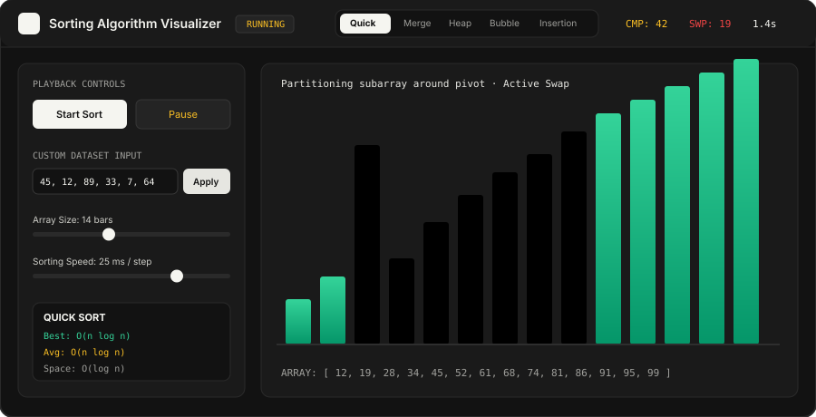
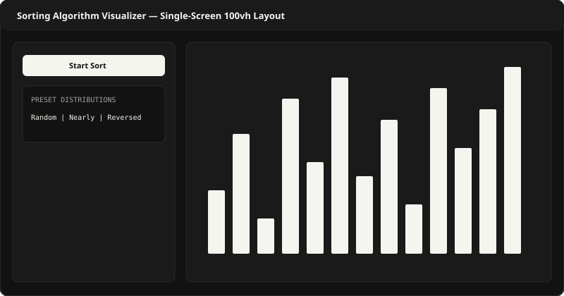
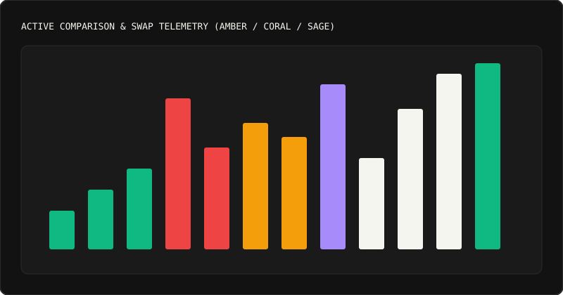
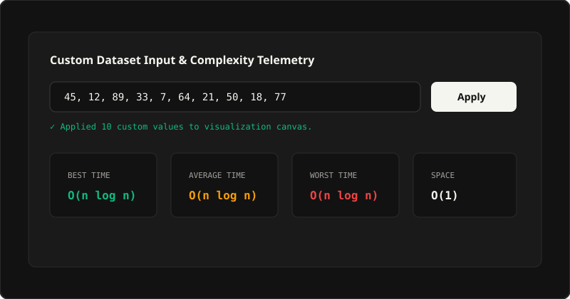

# Sorting Algorithm Visualizer — Web Studio

An interactive, single-screen **Sorting Algorithm Visualizer** designed for the web so anyone can explore sorting mechanics, test custom datasets, and step through algorithms directly in their browser.

## ✨ Key Features

* **Single-Screen (`100vh`) Workspace**: Zero vertical scrolling required—controls, live telemetry, custom dataset inputs, and the visualization stage fit cleanly in one viewport.

* **6 Core Sorting Algorithms**:

  * **Bubble Sort** (`O(n²)` avg, Exchange Sort)

  * **Selection Sort** (`O(n²)` avg, Selection Sort)

  * **Insertion Sort** (`O(n²)` avg, Insertion Sort)

  * **Merge Sort** (`O(n log n)` avg, Divide & Conquer)

  * **Quick Sort** (`O(n log n)` avg, Partitioning Divide & Conquer)

  * **Heap Sort** (`O(n log n)` avg, Binary Max-Heap)

* **Custom Dataset Input**: Paste any comma-separated list of numbers (e.g., `45, 12, 89, 33, 7, 64, 21`) with instant validation.

* **Preset Distribution Generators**: Test algorithm behavior on **Random**, **Nearly Sorted**, **Reversed**, and **Few Unique** datasets.

* **Granular Playback Controls**: Start, Pause/Resume, Step Forward frame-by-frame, or Reset to the initial unsorted state.

* **Real-Time Telemetry**: Live counters for Comparisons (`CMP`), Swaps/Writes (`SWP`), Elapsed Time, and Time/Space complexity badges.

* **Web Audio API Synthesizer**: Optional subtle triangle-wave audio feedback mapped to active bar values.

## 📸 Screenshots & Visuals

| Animated Sorting Showcase | 


| Main Workspace & Controls | 


| Active Partitioning & Comparisons | 


|Custom Dataset & Complexity Telemetry| 



## 🧮 Algorithm Complexity Reference

| Algorithm | Best Time | Average Time | Worst Time | Space Complexity | In-Place | 
| ----- | ----- | ----- | ----- | ----- | ----- | 
| **Bubble Sort** | `O(n)` | `O(n²)` | `O(n²)` | `O(1)` | Yes | 
| **Selection Sort** | `O(n²)` | `O(n²)` | `O(n²)` | `O(1)` | Yes | 
| **Insertion Sort** | `O(n)` | `O(n²)` | `O(n²)` | `O(1)` | Yes | 
| **Merge Sort** | `O(n log n)` | `O(n log n)` | `O(n log n)` | `O(n)` | No | 
| **Quick Sort** | `O(n log n)` | `O(n log n)` | `O(n²)` | `O(log n)` | Yes | 
| **Heap Sort** | `O(n log n)` | `O(n log n)` | `O(n log n)` | `O(1)` | Yes | 

## 📂 Project Structure

```
sorting-algorith-visualizer/
├── index.html                        # Standalone Web Visualizer (HTML5, Tailwind CSS, JS)
├── README.md                         # Project documentation
└── assets/                           # Visual showcases & screenshots
    ├── sorting-demo.svg              # Animated sorting showcase (SVG animation)
    ├── screenshot-overview.svg       # Full single-screen UI overview
    ├── screenshot-comparison.svg     # Active Quick/Merge sort comparison state
    └── screenshot-custom-data.svg    # Custom dataset input & complexity telemetry view

```

## 🚀 Local Setup & Deployment (Vercel)

### Run Locally

No build tools or package installations are required.

1. Clone the repository:

   ```
   git clone https://github.com/sameer26412/sorting-algorith-visualizer.git
   
   ```


## 👤 Author

**Sameer** — [@sameer26412](https://github.com/sameer26412)
